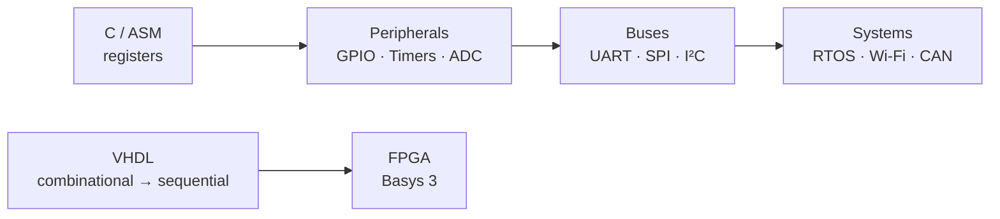

# 🔌 Embedded Systems Labs

**Hands-on microcontroller and FPGA labs — from register-level C and assembly to peripherals, PWM and serial buses.**
KTÜ Electrical & Electronics Engineering · 2025 – 2026

> **RU:** Лабораторные по микроконтроллерам и ПЛИС: STM32 на регистрах, MSP430 ↔ STM32 по I²C/SPI/UART, ESP32 (ESP‑IDF), 8051 на ассемблере и C, VHDL с тестбенчами.
> **TR:** Mikrodenetleyici ve FPGA laboratuvarları: register seviyesinde STM32, I²C/SPI/UART ile MSP430 ↔ STM32, ESP32 (ESP‑IDF), Assembly ve C ile 8051, testbench'li VHDL.

This repository merges my earlier single-board repos (`stm32-f401re-labs`, `8051_LAB_ASM`, `vhdl_lab`, `msp430-labs`, `esp32s_NodeMCU`, `embedded-lab`, MSP430 part of `studyRepo`) into one place. **Their full git history is kept** — `git log -- stm32/` shows it.

---

## 🗂️ Boards

| Folder | Board / tool | What is inside |
|---|---|---|
| [`stm32/`](stm32) | NUCLEO‑F401RE · STM32CubeIDE | register‑level GPIO blink · bare‑metal PWM on TIM1_CH1 (PA8) · PWM → RC low‑pass → ADC (PA0) → UART |
| [`msp430/`](msp430) | MSP430 + STM32 (HAL) | I²C, SPI and UART: MSP430 test side and STM32 data‑sending side |
| [`esp32/`](esp32) | ESP32 · ESP‑IDF | blink example with `led_strip` component, CMake build, pytest |
| [`8051/`](8051) | MCS‑51 · SDCC | 6 assembly labs (addressing, arithmetic/BCD, jumps & stack, I/O bits, tables, serial) + 4 embedded‑C labs |
| [`fpga-vhdl/`](fpga-vhdl) | VHDL · GHDL · GTKWave | comparators, decoder, priority encoder, shift / bidirectional / type‑conversion demos, each with a testbench |

---

## 🚀 Build

| Board | Toolchain |
|---|---|
| STM32 | STM32CubeIDE, or `arm-none-eabi-gcc` + `st-flash` |
| MSP430 | Code Composer Studio (CCS) |
| ESP32 | ESP‑IDF: `idf.py set-target esp32 && idf.py build flash monitor` |
| 8051 | SDCC: `sdcc main.c` → `packihx main.ihx > main.hex` |
| VHDL | `make` in a lab folder (GHDL), waveforms in GTKWave |

Build outputs are not committed (see `.gitignore`).

## 🛣️ Next

- [ ] STM32: UART printf, SPI master, single‑channel ADC, interrupts, DMA
- [ ] MSP430: GPIO, timers, ADC labs on MSP‑EXP430FR4133
- [ ] ESP32: Wi‑Fi, MQTT, FreeRTOS tasks
- [ ] FPGA: sequential designs on the Basys 3 board

Larger projects built on these skills: EMS levitation driver (STM32G474), radar systems with HackRF — see my [profile](https://github.com/Bugee03).
