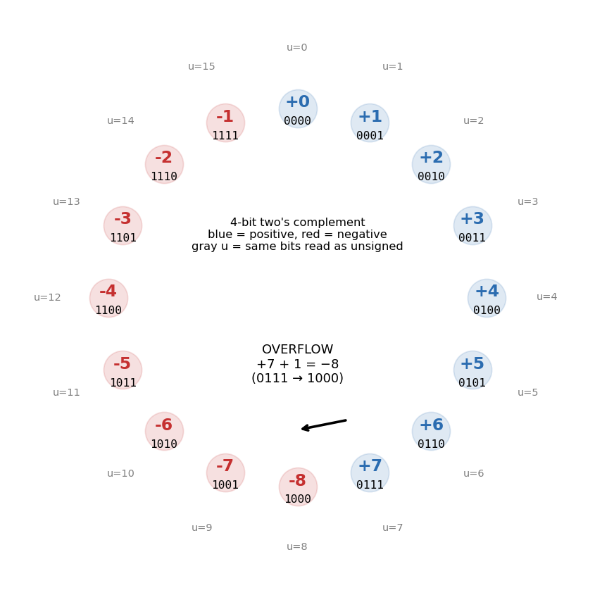
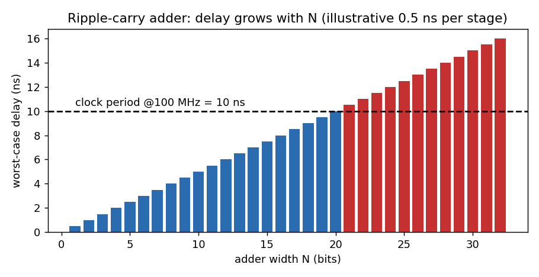

# L01 — Dijital Mantık: FPGA'nın Alfabesi

> **Süre:** 2–3 oturum · **Önkoşul:** yok · **Çıktı:** kağıt hesaplar + 3 simüle edilmiş Verilog modülü
>
> **Okuma (bu sırayla):**
> 1. Bu dosya (tamamı)
> 2. MER Ch 3 *Boolean Algebra and the Look-Up Table*
> 3. MER Ch 10 → *Numerical Data Types* → *Addition* → *Subtraction* (VHDL kısımlarını atla)
> 4. CHU Ch 1 → 1.1–1.5 (**PDF 34–42**)

---

## 0. Büyük fikir — FPGA'da "kod" yazmıyorsun, **devre çiziyorsun**

C / Python'da kod = CPU'nun sırayla yaptığı **komutlar**.
Verilog'da kod = **kabloların ve kapıların tarifi**. Tüm satırlar **aynı anda, paralel** çalışır.

**Basit örnek:**
```c
// C: CPU önce x'i, sonra y'yi hesaplar (sıralı)
x = a & b;
y = c | d;
```
```verilog
// Verilog: iki ayrı devre, AYNI ANDA çalışıyor. Satır sırası önemsiz.
assign y = c | d;
assign x = a & b;
```
Kafandaki resim şu olmalı:
```
 a ──┐           c ──┐
     AND ── x        OR ── y        ← iki bağımsız kapı, aynı anda
 b ──┘           d ──┘
```
Bu yüzden radar için FPGA kullanılıyor: 1 CPU saniyede ~milyar işlem yapar ama **sırayla**;
FPGA'da 90 çarpıcıyı (DSP48 — Digital Signal Processing slice, *блок умножения*) **aynı anda** çalıştırırsın.

---

## 1. Boolean cebri ve doğruluk tablosu

### 1.1 Teori
Her dijital devre = girişlerden çıkışa bir **fonksiyon**. Bunu 3 şekilde yazabilirsin — hepsi aynı şey:
1. **Doğruluk tablosu** (truth table — *таблица истинности*)
2. **Boolean ifade** (ör. $y = ab + \bar{c}$)
3. **Kapı şeması** / Verilog

| Kapı | Sembol | Verilog | Ne zaman 1? |
|---|---|---|---|
| AND | $a \cdot b$ | `a & b` | ikisi de 1 |
| OR | $a + b$ | `a \| b` | en az biri 1 |
| NOT | $\bar{a}$ | `~a` | a = 0 |
| XOR | $a \oplus b$ | `a ^ b` | **farklı** ise |

> ⚠️ `+` Boolean'da OR demek, Verilog'da `+` **toplama** demek! Verilog'da OR için hep `|` yaz.

### 1.2 Basit (radar) örnek — **Çoğunluk oylayıcı** (majority voter — *мажоритарный элемент*)
Senaryo: 3 alıcı (receiver) var. Her biri "hedef gördüm" (1) veya "görmedim" (0) diyor.
**En az 2'si** "gördüm" derse → alarm (y = 1). Bu, tek alıcıdaki gürültünün yanlış alarm üretmesini engeller.

**Adım 1 — Doğruluk tablosu** (3 giriş → $2^3 = 8$ satır):

| a | b | c | kaç tane 1? | y |
|---|---|---|---|---|
| 0 | 0 | 0 | 0 | 0 |
| 0 | 0 | 1 | 1 | 0 |
| 0 | 1 | 0 | 1 | 0 |
| 0 | 1 | 1 | 2 | **1** |
| 1 | 0 | 0 | 1 | 0 |
| 1 | 0 | 1 | 2 | **1** |
| 1 | 1 | 0 | 2 | **1** |
| 1 | 1 | 1 | 3 | **1** |

**Adım 2 — Boolean ifade.** Mantık: "herhangi bir **ikili** aynı anda 1 ise" →
$$y = ab + bc + ac$$
- $ab$: a ve b gördü · $bc$: b ve c gördü · $ac$: a ve c gördü · $+$ = OR (hangisi olursa)

**Sayısal kontrol:** $a=1, b=0, c=1$ → $ab = 0,\ bc = 0,\ ac = 1$ → $y = 0+0+1 = 1$ ✅ (tablodaki 6. satır)

**Adım 3 — Verilog** (sadece OKU, alıştırmada kendin yazacaksın):
```verilog
module majority3 (
    input  wire a, b, c,
    output wire y
);
    assign y = (a & b) | (b & c) | (a & c);
endmodule
```

### 1.3 FPGA bu devreyi nasıl yapar? → **LUT (Look-Up Table — *таблица поиска*, по сути маленькая память)**
FPGA'da gerçek AND/OR kapıları **yok**! Onun yerine **LUT** var: küçük bir bellek.
- Girişler = **adres**
- Bellekteki değer = **çıkış**
- Yani LUT = doğruluk tablosunun **aynen belleğe yazılmış hali**.

Majority voter için 3-girişli LUT: adres $\{a,b,c\}$ = 0…7, içerik (adres 7'den 0'a) = `1110 1000` = `0xE8`.
```
adres (abc):  000 001 010 011 100 101 110 111
içerik (y):    0   0   0   1   0   1   1   1     → tek LUT, gecikme hep aynı
```
**Sezgi:** 3-girişli ne kadar karmaşık fonksiyon yazarsan yaz → **1 LUT**.
Basys3'teki Artix-7'de LUT'lar **6 girişli** → 6 girişe kadar HER fonksiyon = 1 LUT ($2^6 = 64$ bitlik bellek).
Basys3'te **20 800** tane var. (L02'de detaylı.)

---

## 2. Sayı sistemleri

### 2.1 Unsigned (işaretsiz)
$N$ bit, bitler $b_{N-1} \dots b_1 b_0$:
$$u = \sum_{i=0}^{N-1} b_i \cdot 2^i \qquad \text{aralık: } 0 \ \dots\ 2^N - 1$$
- $b_i$: i'nci bit (0 veya 1) · $2^i$: o bitin "ağırlığı" · $\sum$: hepsini topla

**Örnek:** `1011` → $1\cdot8 + 0\cdot4 + 1\cdot2 + 1\cdot1 = 11$. 4 bit aralığı: $0 \dots 15$.

**Hex (onaltılık):** 4 bit = 1 hex hane. `1011_0100` = `B4`. Verilog'da: `8'hB4` = `8'b1011_0100` = `8'd180`.
```
Verilog sayı yazımı:   <bit genişliği>'<taban><değer>
   8'hB4   → 8 bit, hex B4
   4'b1011 → 4 bit, binary
   12'd100 → 12 bit, decimal 100
```

### 2.2 Two's complement (ikiye tümleyen — *дополнительный код*) — işaretli sayılar
**Neden önemli:** ADC (Analog-to-Digital Converter — *АЦП*) çıkışı, radar örnekleri, HackRF'in IQ örnekleri, filtre katsayıları → **hepsi işaretli**. Sinyal +/− salınır.

**Tanım:** en üst bitin (MSB — Most Significant Bit — *старший бит*) ağırlığı **negatif**:
$$x = -b_{N-1}\cdot 2^{N-1} + \sum_{i=0}^{N-2} b_i \cdot 2^i \qquad \text{aralık: } -2^{N-1}\ \dots\ 2^{N-1}-1$$

**Örnek (4 bit):** `1101` →
$$x = -1\cdot 8 + 1\cdot4 + 0\cdot2 + 1\cdot1 = -8 + 5 = -3$$
Aynı bitler unsigned okunursa: $8+4+1 = 13$. **Bitler aynı, yorum farklı!** (Verilog'da `signed` kelimesi bu yorumu seçer.)

**Negatif alma kuralı:** $-x$ = **bitleri ters çevir + 1**
```
+3  = 0011
ters: 1100
 +1 : 1101   = −3 ✅
```
**Neden çalışıyor?** $x + \bar{x} = 1111 = -1$ olduğundan $\bar{x} = -x - 1$ → $\bar{x}+1 = -x$.



**Çarkın sezgisi (araba kilometre sayacı gibi):** +1 eklemek = saat yönünde bir adım.
`0111` (+7) → +1 → `1000` (**−8**)! Buna **overflow** (taşma — *переполнение*) denir.
Donanım uyarmaz — sen **bit genişliğini doğru seçmek** zorundasın.

### 2.3 Sign extension (işaret genişletme — *расширение знака*)
4-bit sayıyı 8-bit'e taşırken: **MSB'yi sola kopyala**.
```
−3 (4 bit) =      1101
−3 (8 bit) = 1111_1101   ✅  (MSB=1 kopyalandı)
yanlış:      0000_1101   = +13 ❌
```
Verilog: `wire signed [7:0] y = {{4{x[3]}}, x};` (replication `{4{...}}` = 4 kez kopyala)

---

## 3. Bit büyümesi (bit growth — *рост разрядности*) — FPGA mühendisinin 1 numaralı hesabı

### 3.1 Kurallar
| İşlem | Giriş | Çıkış için gereken bit |
|---|---|---|
| Toplama | $N$ bit + $N$ bit | $N+1$ |
| Çarpma | $N$ bit × $M$ bit | $N+M$ |
| $K$ tane sayıyı toplama | $K$ × $N$ bit | $N + \lceil \log_2 K \rceil$ |

- $\lceil \cdot \rceil$: yukarı yuvarla (ceil) · $\log_2 K$: "K kaç tane ikiye katlama eder"

### 3.2 Basit örnekler
**Toplama:** 4-bit unsigned, en büyük = 15. $15 + 15 = 30$ → 30 için 5 bit lazım (`11110`). ✅ $4+1 = 5$

**Çarpma:** 4-bit signed, en kötü durum $(-8)\times(-8) = +64$. 64 için signed kaç bit? $+64$ sığsın → $-128\dots127$ → 8 bit. ✅ $4+4 = 8$

**Radar örneği:** XADC (Xilinx ADC — *встроенный АЦП*) 12-bit örnek veriyor. 16 örneği topluyorsun (ortalama/entegrasyon):
$$12 + \lceil \log_2 16 \rceil = 12 + 4 = 16 \text{ bit}$$
16 bitten azına koyarsan → overflow → sahte hedef veya kayıp hedef. **Gerçek sistemlerde en sık yapılan hata budur.**

---

## 4. Temel yapı taşları

### 4.1 Multiplexer (MUX — *мультиплексор*, "seçici anahtar")
**Basit örnek:** TV kumandası. `s` = kanal seçimi. `s=0` → a kanalı, `s=1` → b kanalı.
$$y = \bar{s}\,a + s\,b$$
```
 a ──┐
     │MUX├── y        Verilog:  assign y = s ? b : a;
 b ──┘
      s (seçim)
```
Kontrol: $s=1, a=0, b=1$ → $\bar{s}a = 0\cdot0 = 0,\ sb = 1\cdot1 = 1$ → $y=1 = b$ ✅

**Radar:** Test modunda sentetik hedef mi, gerçek ADC verisi mi → bir MUX.

### 4.2 Decoder (kod çözücü — *дешифратор*)
**Basit örnek:** Asansör düğmesi. 2-bitlik kat numarası → 4 kat lambasından **tam birini** yak.

| sel[1:0] | y[3:0] |
|---|---|
| 00 | 0001 |
| 01 | 0010 |
| 10 | 0100 |
| 11 | 1000 |

Verilog'da: `assign y = 4'b0001 << sel;` · **Radar:** Hangi anten/kanalın aktif olduğunu seçmek. Basys3'te: 7-segment'in hangi hanesi yanacak (L09).

### 4.3 Half adder (yarım toplayıcı) — smoke test'te zaten gördün
$$s = a \oplus b \qquad c_{out} = a\cdot b$$
$1+1 = 10_2$ → sum = 0, carry = 1.

### 4.4 Full adder (tam toplayıcı — *полный сумматор*)
Elle çok haneli toplama yaparken her sütunda **3 sayı** toplarsın: a, b ve **önceki sütundan elde** ($c_{in}$).
$$s = a \oplus b \oplus c_{in}$$
$$c_{out} = a\,b + c_{in}\,(a \oplus b)$$
- $s$: "tek sayıda 1 varsa" 1 (XOR'un anlamı)
- $c_{out}$: "ya a ve b ikisi 1, ya da biri 1 ve elde de 1"

**Sayısal kontrol:** $a=1, b=1, c_{in}=1$ → $1+1+1 = 3 = 11_2$
- $s = 1\oplus1\oplus1 = 0\oplus1 = 1$ ✅
- $c_{out} = 1\cdot1 + 1\cdot(0) = 1$ ✅ → sonuç `11` = 3 ✅

İlginç: $c_{out}$ = majority3(a, b, c_in)! Bölüm 1.2'deki oylayıcıyla **aynı fonksiyon**.

### 4.5 Ripple-carry adder (dalgalı elde toplayıcı) ve **gecikme**
4 full adder'ı zincirle → 4-bit toplayıcı. Elde soldan sağa değil, **sağdan sola dalga gibi** ilerler:
```
   a3 b3      a2 b2      a1 b1      a0 b0
    │  │       │  │       │  │       │  │
  ┌─┴──┴─┐   ┌─┴──┴─┐   ┌─┴──┴─┐   ┌─┴──┴─┐
c4│  FA  │c3 │  FA  │c2 │  FA  │c1 │  FA  │ c0 = 0
 ◄┤      │◄──┤      │◄──┤      │◄──┤      │◄──
  └──┬───┘   └──┬───┘   └──┬───┘   └──┬───┘
     s3         s2         s1         s0
```
**Gecikme (propagation delay — *задержка распространения*):** En kötü durumda elde **N kat** boyunca yürür:
$$t_{toplam} \approx N \cdot t_{FA}$$

**Sayısal örnek** (örnek amaçlı $t_{FA} = 0.5$ ns):
- 16 bit: $16 \times 0.5 = 8$ ns < 10 ns ✅ (100 MHz saate sığar)
- 32 bit: $32 \times 0.5 = 16$ ns > 10 ns ❌ → sonuç bir sonraki saat vuruşuna **yetişmez** → hatalı veri



**Sonuç:** Bu yüzden FPGA'larda toplama için özel hızlı **carry chain** (CARRY4 — *цепь быстрого переноса*) vardır;
ve uzun işlemler **pipeline** ile parçalanır (L11). Şimdilik sadece şunu bil: **her kapının bir gecikmesi var ve saat periyodu bir bütçedir.**

---

## 5. Terminal — adım adım (Alıştırma 7–9 için)
```bash
# 1) Lab klasörünü aç
cd ~/Desktop/fpga
mkdir -p labs/L01 && cd labs/L01

# 2) Dosyaları EDİTÖRDE kendin yaz (PyCharm veya terminal editörü)
#    majority3.v, tb_majority3.v, full_adder.v, tb_full_adder.v, adder4.v, tb_adder4.v
nano majority3.v            # ya da: open -a PyCharm majority3.v

# 3) Derle + çalıştır (her modül için)
iverilog -g2005 -Wall -o sim.out majority3.v tb_majority3.v
vvp sim.out

# 4) Lint (kod denetimi)
verilator --lint-only -Wall majority3.v

# 5) Dalga formu
gtkwave majority3.vcd &

# 6) Donanım karşılığını gör (Yosys) — kaç LUT?
yosys -p "read_verilog majority3.v; synth_xilinx -top majority3; stat"
#    → çıktıda "LUT3" veya "LUT6" satırını bul: 1 adet olmalı!

# 7) Kağıt hesapları kontrol etmek için Python yardımcı:
python3 ../../lessons/L01_digital_logic/twos.py -3 4       # −3'ü 4 bit göster
python3 ../../lessons/L01_digital_logic/twos.py 0b1101 4   # 1101'i yorumla
```
Testbench iskeleti için `00_setup/smoke_test/tb_half_adder.v`'ye **bakabilirsin** (kopyalama, yapıyı anla).

---

## 6. Alıştırmalar

### Kağıt (defterde, hesap makinesi YOK)
1. `10110110` → unsigned? signed (8-bit two's complement)? hex?
2. $-37$'yi 8-bit two's complement yaz. Adımları göster (binary → ters → +1).
3. 4-bit signed: $5 + 4 = ?$ Bit düzeyinde topla. Sonuç ne çıktı, neden yanlış? Çarkta göster.
4. $-5$ (4-bit) → 8-bit sign extension. Sonra yanlış yöntemle (sıfır ekleyerek) yap ve değerini hesapla.
5. Bit büyümesi: 14-bit signed ADC örneği × 16-bit signed katsayı, 64 tane toplanıyor (bir FIR filtre). Sonuç kaç bit? (formülü yaz + sayı koy)
6. 3-girişli şu fonksiyonun LUT içeriğini hex olarak bul: $y = a \oplus b \oplus c$ (parite).

### Verilog (elle yaz, simüle et)
7. **`majority3.v` + `tb_majority3.v`** — testbench **8 kombinasyonun hepsini** denesin ve **kendi kendini kontrol etsin**
   (ipucu: beklenen değeri $a+b+c \geq 2$ ile hesapla).
8. **`full_adder.v`** — sadece `assign` ve `^ & |` kullanarak. Testbench: 8 kombinasyon, beklenen = `a + b + cin`.
9. **`adder4.v`** — 4 tane `full_adder` **instance** (örnek) kullanarak (CHU 1.6 *Structural description*, **PDF 42–45**'e bak).
   Çıkışlar: `sum[3:0]`, `cout`, ve **`ovf`** (signed overflow bayrağı).
   Testbench: **256 kombinasyonun hepsi** (`for` döngüsü, `i` 0..255 → `{a,b} = i`).
   - Unsigned kontrol: `{cout, sum} == a + b`
   - Signed overflow kuralı: iki sayının işareti **aynı** ve sonucun işareti **farklıysa** overflow.
     $$ovf = (a_3 \odot b_3) \cdot (s_3 \oplus a_3)$$
     ($\odot$ = XNOR = "eşit mi?", Verilog'da `~(a[3]^b[3])`)

**Bitirme kriteri:** üç testbench de `ALL TESTS PASSED` basmalı, `verilator --lint-only -Wall` uyarısız geçmeli.

### Bonus (HackRF — sadece alma/receive)
HackRF IQ (In-phase/Quadrature — *синфазная/квадратурная составляющие*) örnekleri **8-bit signed** (int8, two's complement).
```bash
hackrf_transfer -r fm.iq -f 100000000 -s 2000000 -n 200000   # 100 MHz FM, 0.1 s
python3 -c "
import numpy as np
x = np.fromfile('fm.iq', dtype=np.int8)[:10]
for v in x: print(f'{int(v):5d}  {int(v) & 0xFF:08b}')
"
```
Soru: negatif örneklerin MSB'si ne? En büyük/en küçük değer ne olabilir? Bu, FPGA'ya gelen gerçek bir sinyal gibi.

---

## 7. Doc Hunt (cevabı bul, **sayfa numarasıyla** deftere yaz)
1. CHU 1.4.1: Verilog'daki **4 değer** hangileri? `x` ve `z` ne demek? (PDF ~37)
2. CHU 3.2.8 *Expression bit-length adjustment* (**PDF 79**): `a + b` ifadesinde `a`, `b` 4-bit ve sonuç 5-bit bir değişkene atanıyorsa elde biti kaybolur mu?
3. MER Ch 3: LUT bölümünde yazar LUT'u neyle karşılaştırıyor?
4. MER Ch 10 *Sizing Signals Appropriately*: yazarın toplama için verdiği kural ne? Bizim formülle aynı mı?

---

## 8. Radar bağlantısı
| Bu derste | Radar zincirinde |
|---|---|
| Two's complement | ADC örnekleri, IQ verisi, FIR katsayıları — **hepsi** signed |
| Bit büyümesi | FIR / matched filter / FFT çıkış genişliği hesabı; yanlış → sahte hedef |
| Overflow | Güçlü yankı (yakın hedef) toplayıcıyı taşırır → işaret döner → çöp veri |
| MUX | Test modu (sentetik hedef) ↔ gerçek veri seçimi |
| Majority voter | Çok kanallı tespit onayı, M-of-N detection mantığı |
| Gecikme / carry chain | 100 MHz'de hangi işlemin tek saatte bitebileceği → pipeline tasarımı |

## 9. Kontrol listesi — L02'ye geçmeden
- [ ] Verilog'un **paralel** çalıştığını bir örnekle açıklayabiliyorum
- [ ] Herhangi 3-girişli fonksiyonun doğruluk tablosunu → LUT içeriğine çevirebiliyorum
- [ ] 8-bit two's complement'te negatif sayıyı elle yazabiliyorum (ters + 1)
- [ ] Sign extension'ı ve neden gerektiğini biliyorum
- [ ] Toplama / çarpma / K-toplam için bit büyümesini formülle hesaplayabiliyorum
- [ ] Full adder denklemlerini ezbere yazabiliyorum
- [ ] Ripple-carry gecikmesinin neden saat hızını sınırladığını açıklayabiliyorum
- [ ] 3 testbench `ALL TESTS PASSED`

Bitirince: defter fotoğraflarını `notebook/` içine koy, bana **"L01 bitti"** yaz → kodunu gözden geçiririm, sonra L02 (FPGA'nın içi).
